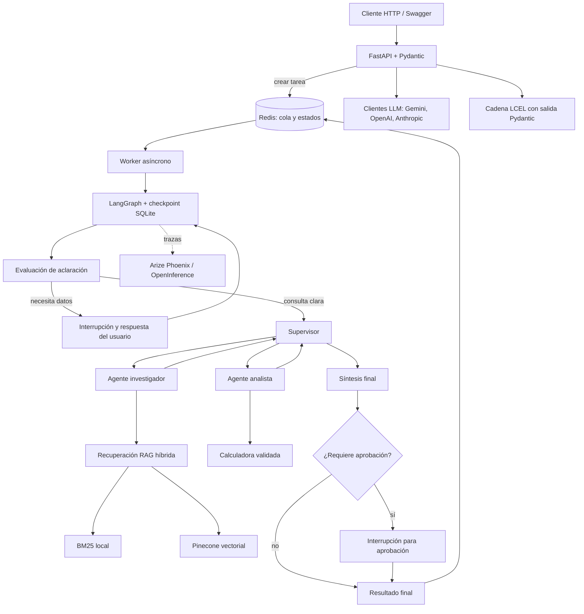

# ProyectoFinal — Sistema multiagente de investigación sobre videojuegos

**Stack:** Python 3.12 · FastAPI · LangGraph · LangChain · Redis · SQLite · Pinecone · BM25 · Gemini · Arize Phoenix · Pydantic.

## 1. Descripción

Proyecto integrador que combina clientes de modelos de lenguaje, una cadena LCEL con salida estructurada, recuperación aumentada por generación (RAG) y un flujo multiagente coordinado por LangGraph. La API permite enviar tareas, consultar su estado, responder aclaraciones, aprobar resultados cuando corresponde y reanudar tareas que hayan fallado por errores temporales.

El dominio de prueba es videojuegos. El repositorio incluye documentos Markdown sobre Resident Evil 4, Hollow Knight, Minecraft y Dark Souls.

## 2. Arquitectura



### Componentes principales

- **FastAPI:** expone los endpoints y la documentación OpenAPI/Swagger.
- **Redis:** mantiene la cola de trabajos y los estados de las tareas.
- **Worker asíncrono:** toma los trabajos de Redis y ejecuta el grafo.
- **LangGraph:** coordina la evaluación de aclaraciones, el supervisor, los agentes, la síntesis y las interrupciones humanas.
- **Agente investigador y RAG híbrido:** recupera información mediante BM25 y Pinecone.
- **Agente analista y calculadora:** permite realizar cálculos controlados cuando la tarea lo requiere.
- **Pydantic:** valida las solicitudes, los estados y las salidas estructuradas.
- **SQLite / AsyncSqliteSaver:** persiste los checkpoints del grafo en `checkpoints.sqlite`.
- **Arize Phoenix y OpenInference:** instrumentan las llamadas de LangChain para inspeccionar trazas.
- **Clientes del Módulo 1 y cadena LCEL del Módulo 2:** se exponen también mediante endpoints independientes.

## 3. Requisitos previos

1. Windows 10/11 y PowerShell.
2. Python **3.12** disponible como `py -3.12` o `python`.
3. Redis iniciado y accesible. Por defecto: `redis://localhost:6379/0`.
4. Una clave de Google Gemini (`GOOGLE_API_KEY`) para el flujo principal.
5. Una clave de Pinecone (`PINECONE_API_KEY`) y un índice accesible para RAG.
6. Para los endpoints de clientes alternativos, las claves de OpenAI o Anthropic correspondientes.

Phoenix se inicia desde `run.ps1` si las dependencias están instaladas. SQLite no requiere un servidor externo. El flujo principal depende de servicios externos y puede fallar si no hay cuota disponible en el proveedor de modelos.

## 4. Instalación en Windows (PowerShell)

Abrir PowerShell en la carpeta raíz del proyecto, donde están `main.py`, `run.ps1` y `requirements.txt`.

```powershell
py -3.12 -m venv .venv
.\.venv\Scripts\Activate.ps1
python -m pip install --upgrade pip
python -m pip install -r requirements.txt
Copy-Item .env.example .env
```

Si PowerShell bloquea la activación del entorno por la política de ejecución, permitir scripts únicamente en la sesión actual:

```powershell
Set-ExecutionPolicy -Scope Process -ExecutionPolicy Bypass
.\.venv\Scripts\Activate.ps1
```

Si PowerShell bloquea `run.ps1` porque no está firmado digitalmente, se puede usar la misma excepción temporal y luego ejecutar el script:

```powershell
Set-ExecutionPolicy -Scope Process -ExecutionPolicy Bypass
.\run.ps1
```

La excepción se pierde al cerrar esa ventana de PowerShell; no modifica la política permanente del equipo.

## 5. Configuración de variables de entorno

Editar `.env` y completar las claves necesarias. No incluir el archivo `.env` en la entrega ni compartirlo: contiene credenciales privadas.

Variables principales:

| Variable | Uso |
|---|---|
| `GOOGLE_API_KEY` | Acceso a Gemini, usado por el flujo principal y la evaluación de aclaraciones. |
| `GEMINI_MODEL` | Modelo Gemini; valor predeterminado `gemini-flash-latest`. |
| `PINECONE_API_KEY` | Acceso al vector store de Pinecone. |
| `INDEX_NAME` | Nombre del índice Pinecone; valor predeterminado `videojuegos-rag`. |
| `REDIS_URL` | URL de Redis; valor predeterminado `redis://localhost:6379/0`. |
| `REDIS_QUEUE_NAME` | Nombre de la cola de tareas; valor predeterminado `tasks_queue`. |
| `REDIS_STATUS_PREFIX` | Prefijo de claves de estado; valor predeterminado `task:`. |
| `CHECKPOINT_DB_PATH` | Archivo SQLite de checkpoints; valor predeterminado `checkpoints.sqlite`. |
| `PHOENIX_ENDPOINT` | Endpoint OTLP; valor predeterminado `http://localhost:6006/v1/traces`. |
| `PHOENIX_PROJECT_NAME` | Proyecto en Phoenix; valor predeterminado `ProyectoFinal`. |
| `OPENAI_API_KEY`, `OPENAI_MODEL` | Opcionales; cliente OpenAI. |
| `ANTHROPIC_API_KEY`, `ANTHROPIC_MODEL` | Opcionales; cliente Anthropic. |

## 6. Ingesta de documentos RAG

La ingesta se realiza cuando se quiere cargar o actualizar los documentos del directorio `data/` en Pinecone. No es necesario repetirla en cada arranque si el índice ya está preparado.

```powershell
python ingest.py
```

La ingesta lee los documentos, los divide en fragmentos, crea embeddings con el modelo de Hugging Face configurado en el código y carga los fragmentos en el índice Pinecone. Requiere conexión a Internet y credenciales válidas.

## 7. Ejecución de la aplicación

1. Asegurarse de que Redis esté iniciado.
2. Activar `.venv` y comprobar que `.env` contiene las claves necesarias.
3. Ejecutar `run.ps1` desde la raíz del proyecto:

```powershell
.\run.ps1
```

El script comprueba la conexión con Redis y la configuración requerida, intenta abrir Phoenix en una ventana minimizada y deja Uvicorn ejecutándose en la terminal.

Direcciones locales:

- **Swagger / API:** http://127.0.0.1:8000/docs
- **Estado de la API:** http://127.0.0.1:8000/
- **Arize Phoenix:** http://localhost:6006

La terminal donde corre Uvicorn debe permanecer abierta mientras se utiliza la API. Para detenerlo, presionar `Ctrl+C`.

## 8. Endpoints principales

### Crear una tarea multiagente

`POST /tasks`

```json
{
  "query": "Compara la exploración de Resident Evil 4 y Dark Souls",
  "requires_approval": false
}
```

Devuelve un identificador `job_id` y el estado inicial `PENDING` (HTTP 202). Usar `GET /tasks/{job_id}` para consultar el avance.

### Consultar el estado

`GET /tasks/{job_id}`

Estados que puede devolver la implementación: `PENDING`, `RUNNING`, `WAITING_CLARIFICATION`, `WAITING_APPROVAL`, `RETRYABLE`, `DONE`, `FAILED` o `REJECTED`.

- `WAITING_CLARIFICATION`: el flujo necesita una respuesta del usuario. Enviar la respuesta a `POST /tasks/{job_id}/clarify` con el cuerpo `{"answer":"..."}`.
- `WAITING_APPROVAL`: el flujo espera una decisión humana. Usar `POST /tasks/{job_id}/approve` con `{"approved":true}` o `{"approved":false}`.
- `RETRYABLE`: el flujo falló por un error considerado recuperable y conserva su checkpoint. Cuando el proveedor vuelva a aceptar solicitudes, se puede solicitar la reanudación con `POST /tasks/{job_id}/retry`.
- `DONE`: el resultado final está disponible en el campo `result`.
- `FAILED`: ocurrió un error que no se clasificó como recuperable; consultar `error` y los logs.

No reintentar repetidamente ante un `429 RESOURCE_EXHAUSTED`: si la cuota diaria está agotada, hay que esperar a que se restablezca o utilizar un proveedor/modelo con cuota disponible.

### Aprobar una tarea

`POST /tasks/{job_id}/approve`

```json
{"approved": true}
```

### Aclarar una tarea

`POST /tasks/{job_id}/clarify`

```json
{"answer": "Me interesa principalmente la historia y el diseño de niveles"}
```

### Reanudar una tarea recuperable

`POST /tasks/{job_id}/retry`

Se utiliza manualmente después de corregir la causa temporal. La reanudación usa el `thread_id` de la tarea para continuar desde el checkpoint, en vez de crear un trabajo nuevo.

### Clientes asíncronos de modelos (Módulo 1)

`POST /llm/chat`

```json
{
  "provider": "gemini",
  "messages": [
    {"role": "user", "content": "Resume qué es un videojuego"}
  ]
}
```

Los proveedores disponibles dependen del enum `Provider` y de que las claves correspondientes estén configuradas.

### Cadena LCEL estructurada (Módulo 2)

`POST /analysis`

```json
{
  "provider": "gemini",
  "text": "Texto del videojuego que se quiere analizar"
}
```

Devuelve una estructura validada mediante Pydantic (`AnalisisVideojuego`).

## 9. Persistencia y manejo de errores

- Redis conserva la cola y el estado actual de cada tarea.
- `AsyncSqliteSaver` conserva el estado interno de LangGraph en el archivo SQLite indicado por `CHECKPOINT_DB_PATH`.
- Las tareas que requieren intervención humana quedan interrumpidas en el checkpoint y esperan una respuesta/aprobación.
- Los errores temporales (por ejemplo, timeout, desconexión, HTTP 5xx o `429 RESOURCE_EXHAUSTED`) se deben manejar sin reintentos automáticos ilimitados. Cuando se clasifica un error como recuperable, se informa el estado `RETRYABLE` y se permite reanudar manualmente.
- Los errores de validación o los errores definitivos no se deben reintentar a ciegas.

Un `429` de Gemini puede significar que se agotó la cuota gratuita por día/modelo. El código no puede restaurar esa cuota; hay que esperar el periodo indicado por el proveedor o configurar una opción con cuota disponible.

## 10. Observabilidad con Arize Phoenix

`app/observability.py` configura OpenInference para instrumentar LangChain y exportar trazas al endpoint configurado en `PHOENIX_ENDPOINT`.

### Verificar la recepción de una traza sintética

Con Phoenix iniciado, abrir otra terminal en la raíz del proyecto y ejecutar:

```powershell
python scripts/verificar_phoenix.py
```

Luego abrir http://localhost:6006 y buscar el span `verificacion_phoenix_proyecto_final` en el proyecto `ProyectoFinal`. La salida de la terminal confirma que se emitió la traza; la evidencia definitiva es verla en la interfaz.

Para observar una ejecución real, enviar una tarea por `POST /tasks` y consultar en Phoenix los spans generados por las llamadas de LangChain. Si el proveedor devuelve un error de cuota, también se puede observar la ejecución hasta el punto del fallo.

## 11. Pruebas y evaluación

### Suite automatizada

Con `.venv` activado:

```powershell
python -m pytest -q
```

La suite cubre validación de entradas, herramientas, manejo de errores y pruebas relacionadas con checkpoint. Las pruebas unitarias no equivalen a una ejecución integral de todos los proveedores externos.

### Prueba específica de manejo de errores

```powershell
python -m pytest -q tests/test_error_handling.py
```

### Comprobación de Redis

```powershell
python scripts/check_redis.py
```

### Carga concurrente de cinco consultas

Con API, Redis, claves y cuota de modelo disponibles:

```powershell
python load_test.py
```

Este script envía cinco consultas concurrentes y mide los tiempos. No ejecutarlo mientras el proveedor tenga la cuota agotada, ya que las llamadas reales pueden fallar con `429`.

### Evaluación de recuperación RAG

Con índice Pinecone creado y documentos cargados:

```powershell
python evaluate.py
```

Evalúa los documentos recuperados frente a `golden_set.json` y calcula Recall@5 y Precision@5. Necesita acceso a los servicios externos y no es una prueba unitaria aislada.

### Evidencia de ejecución conocida

En el entorno de desarrollo reportado para esta entrega, `python -m pytest -q` finalizó con **12 passed y 1 warning de deprecación**. `python scripts/verificar_phoenix.py` informó que la traza de verificación fue emitida. Para confirmar observabilidad de extremo a extremo, la traza debe verse en la interfaz de Phoenix; el envío por sí solo no demuestra que se almacenó.

## 12. Generar o actualizar `requirements.txt`

Para generar una lista reproducible de los paquetes instalados en el entorno virtual que acaba de pasar las pruebas, activar primero `.venv` y ejecutar desde la raíz del proyecto:

```powershell
python -m pip freeze | Set-Content -Encoding ascii requirements.txt
```

Verificar que se está usando el Python del entorno virtual:

```powershell
python -c "import sys; print(sys.executable)"
```

La ruta debe terminar en `.venv\Scripts\python.exe`. `pip freeze` registra versiones instaladas, incluidas dependencias transitivas. Es útil para reproducir el entorno actual; al cambiar de equipo o Python pueden existir dependencias específicas de plataforma. Después de generar el archivo, comprobar que no incluya rutas locales ni credenciales.

## 13. Criterios de evaluación cubiertos

- **Arquitectura multiagente:** supervisor, agente investigador, agente analista, herramientas, síntesis y flujo de control con LangGraph.
- **Asincronía y validación:** endpoints FastAPI asíncronos, worker con Redis, llamadas asíncronas a modelos y recuperación; modelos Pydantic para entradas y salidas.
- **Persistencia y observabilidad:** Redis para cola/estados, SQLite para checkpoints y trazas instrumentadas mediante OpenInference hacia Arize Phoenix.
- **Ejecución, pruebas y errores:** suite de pruebas automatizadas, verificación de Redis y Phoenix, script de carga, evaluación RAG y clasificación de errores recuperables.
- **Documentación y despliegue local:** este documento detalla arquitectura, dependencias, configuración, ejecución, endpoints, persistencia y comandos de pruebas.

## 14. Seguridad y limitaciones

- No entregar `.env`, claves de API ni credenciales.
- El servicio Redis y el índice Pinecone deben estar disponibles para el flujo integral.
- La cuota y los límites de Gemini dependen de la cuenta y del modelo; el proyecto no puede evitarlos.
- La prueba de Phoenix requiere comprobar el span desde la interfaz gráfica.
- Este proyecto está preparado para ejecución y evaluación local; un despliegue de producción requeriría controles adicionales de autenticación, gestión de secretos, límites de consumo y alta disponibilidad.
